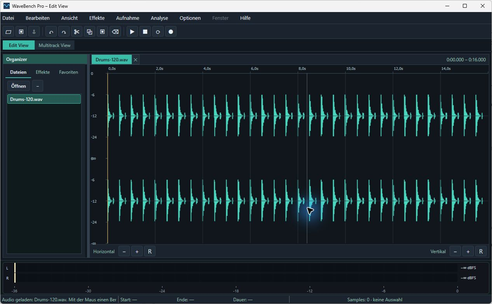
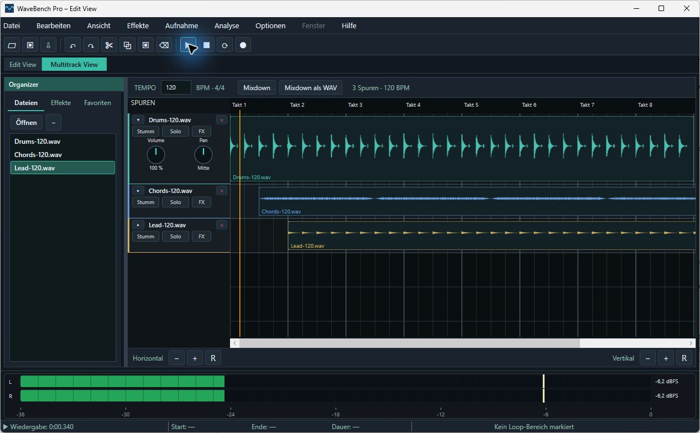

# WaveBench Pro

09A ergänzt Wiederherstellen/Verwerfen/Später, die geprüfte Neuzuordnung fehlender Quellen und **Projekt portabel speichern**. Format 3 erhält Ansichts-/Loop-Zustand und liest Format 2. Speichern ist transaktional und abbrechbar; Fehler lassen das bisherige Projekt und seine Datei bestehen. Details: [Projektformat](docs/ProjectFormat.md). Automatisierte Tests ersetzen keine visuelle GUI- oder echte Audiogeräte-Abnahme.

[English](README.md) · [Bedienung](docs/UserGuide.md) · [Architektur](docs/Architecture.md)

Windows-Audioeditor mit klassischer Wellenformansicht und Mehrspur-Sequenzer. Entwickelt mit C#, WPF, .NET 9 und NAudio.

## Download und Start

Der Kandidat **v0.3.0-beta.3** ist ein unsignierter Entwurf. Abnahme und Prüfung der Drittanbieterbedingungen stehen aus. Ältere Entwicklungsstände stehen bei [GitHub Releases](https://github.com/radioman82/WaveBenchPro/releases).

Das portable ZIP vollständig in einen beschreibbaren Ordner entpacken und **WaveBenchPro.exe** starten. Begleitdateien und Lizenzhinweise zusammenlassen. Die .NET-Laufzeit ist enthalten; zum Start wird kein SDK benötigt. Die Builds sind derzeit nicht signiert.

**Plattform:** Windows 11 x64 mit funktionierendem WASAPI-Audiogerät. Speicher- und Platzbedarf hängen vom Material und den Effekten ab. Die experimentelle Vorbereitung kann bis zu 16 GiB gemeinsamen Disk-Cache nutzen.

## Funktionen

- Auswahl, Ausschneiden, Kopieren, Einfügen, Löschen, Undo/Redo und Auswahl-Schleifen.
- WAV-Zugriff in Blöcken mit Wellenformanalyse im Hintergrund und WAV-Export.
- Wellenform/Spektrogramm und getrennte horizontale/vertikale Zoomtasten mit Reset.
- Stereo-Pegelanzeige mit Peak, RMS, Peak-Hold und Clipping.
- WASAPI Shared als Standard, optional Exclusive-Wiedergabe und getrennte Ein-/Ausgabe: [Audio-Hardware](docs/AudioHardware.md).
- Verstärkung, Normalisierung, Fades, EQ, Hoch-/Tiefpass, Kompressor und Peak-Clipper.
- Installierte VST3-Effekte scannen, bearbeiten, live abhören und offline anwenden.
- Dateien in Mehrspur ziehen: Spuren entstehen automatisch. Beat-/Taktraster, BPM, Clippositionen, Lautstärke, Panorama, Stumm und Solo.
- Spur-Inserts, verschiebbare Auswahl-Schleifen und blockweiser WAV-Mixdown.
- Mehrspurprojekte speichern/öffnen: unveränderte Quellen bleiben Referenzen,
  bearbeitete und aufgenommene Quellen werden projektsicher als Assets abgelegt.
  Details: [Projektformat](docs/ProjectFormat.md).

## Experimentelle Wiedergabe

Unter **Optionen → Mehrspur: neue Wiedergabe (experimentell)** aktivieren. Private Spurdateien einschließlich Effekten werden vorbereitet; Sprünge/Loops lesen danach diesen kontinuierlichen Render.

Die Mixerregler benötigen keine neue Effektvorbereitung. Bereits gepufferte Daten verzögern die Reaktion: 4/8/16 Blöcke à 1024 Frames entsprechen bei 48 kHz etwa 85/171/341 ms, zuzüglich Ausgangspuffer. Die bisherige Engine bleibt Standard und manuell wählbarer Rückfall. Fehler werden gemeldet; Inserts werden nicht still umgangen.

## Bekannte Grenzen

- Die grafische Abnahme der Projekt-Dialoge steht noch aus; die Speicherung und
  Wiederherstellung sind über die Regressionstests abgedeckt.
- Eine vollständige Hardware-Langzeitabnahme steht aus.
- Nach Clip-/Effektänderungen werden alle belegten Spuren vorbereitet. Große Projekte können Minuten und viel Disk benötigen.
- RIFF-WAV-Grenzen gelten. RF64 und Exclusive-Aufnahme fehlen. ASIO und komprimierte Audioformate sind im Beta-Profil bis zur Abnahme beziehungsweise Lizenzklärung deaktiviert. Im normalen Entwicklungsbuild bleiben sie erhalten.
- Native Plugins laufen im Programmprozess und können hängen/abstürzen. Nicht jedes VST3 ist kompatibel oder deterministisch.
- Der Peak-Clipper ist kein Lookahead-Limiter. BPM-Zahlen kommen aus Dateinamen; es gibt keine Beat-Erkennung.
- Startzeit, RAM, akustische Latenz und dauerhaft störungsfreie Wiedergabe sind nicht pauschal zugesichert.

Build-Befehle stehen im [englischen README](README.md#build-and-test) und in der [Architektur](docs/Architecture.md#build-and-packaging). Windows und das zu [global.json](global.json) passende .NET-9-SDK sind nötig.

Probleme nachvollziehbar über [Issues](https://github.com/radioman82/WaveBenchPro/issues) melden; private Pfade/Audiodateien weglassen. Es gibt keine zugesagte Reaktionszeit.

Der eigene Projektcode steht unter der [MIT-Lizenz](LICENSE). Für enthaltene Drittanbieterkomponenten gelten ihre jeweiligen Lizenzbedingungen. [Lizenzstatus](docs/LicenseStatus.md) und [Drittanbieterhinweise](THIRD-PARTY-NOTICES.md) erläutern die offenen Prüfungen für das Paket. Der Beta-Entwurf ist noch nicht zur Weitergabe freigegeben.
