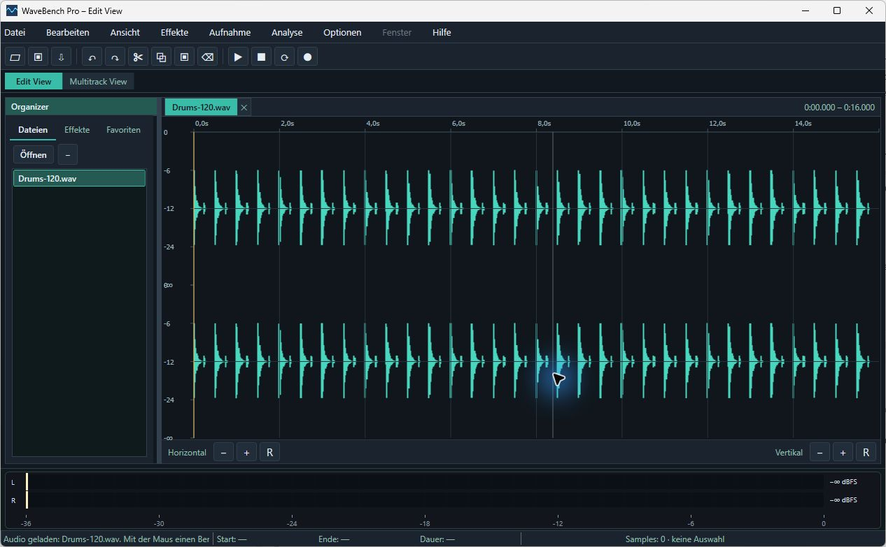
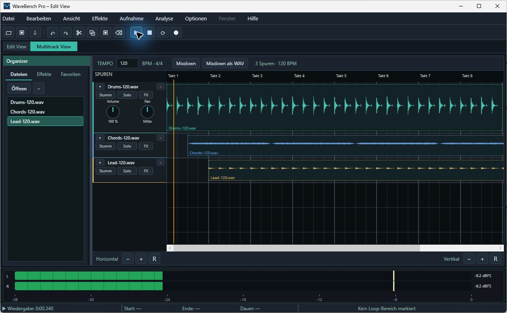

# WaveBench Pro

[Deutsch](README.de.md) · [User guide](docs/UserGuide.md) · [Architecture](docs/Architecture.md)

A Windows audio editor with a classic waveform workspace and a multitrack sequencer. Built with C#, WPF, .NET 9 and NAudio.



## Download and start

See [GitHub Releases](https://github.com/radioman82/WaveBenchPro/releases) for existing development snapshots and their notes. The proposed **v0.3.0-beta.1 is a draft**, pending acceptance and licensing decisions. Older snapshots can differ from this source tree.

Extract the entire portable ZIP into a writable folder and run **WaveBenchPro.exe**. Keep companion files and license notices together. The self-contained package includes the .NET runtime; users do not need the SDK. Builds are currently unsigned.

**Platform:** Windows 11 x64 with a working WASAPI audio device. Disk and memory needs depend on the material/effects; experimental multitrack preparation can use up to 16 GiB of shared disk cache.

## Features

- Waveform selection, cut/copy/paste/delete, undo/redo and selection playback loops.
- Block-based WAV access with background waveform analysis; compressed imports are decoded into memory.
- WAV, FLAC, MP3, Ogg Vorbis and Opus import/export with format settings in the export dialog.
- Waveform/spectrogram, independent horizontal/vertical zoom and reset.
- Stereo peak/RMS metering, peak hold and clipping indication.
- WASAPI Shared playback/recording with input/output device selection.
- Gain, normalization, fades, EQ, high/low-pass, compressor and **peak clipper**.
- Installed VST3 effects: scanning, plugin editors, state, live audition and offline processing.
- Multitrack drag-and-drop, automatic tracks, beat/bar grid, tempo, clip placement, volume, pan, mute and solo.
- Track native/VST3 inserts, movable selection loops and block-based WAV mixdown.



## Experimental playback

Enable **Optionen → Mehrspur: neue Wiedergabe (experimentell)**. The interface currently uses German labels.

This engine prepares private track files before playback. Seeking/looping then read that continuous render. Mixer controls do not rerender effects, but already queued audio delays their response. The buffer offers 4/8/16 blocks of 1024 frames: about 85/171/341 ms at 48 kHz, plus device buffering.

The previous engine remains the default and a manual fallback. Failed inserts are reported rather than silently bypassed.

## Current limitations

- Multitrack projects cannot yet be saved/reopened. Export a mixdown and retain sources separately.
- Full hardware acceptance is pending; short tests do not establish long-session reliability.
- Clip/effect changes rerender all occupied tracks. Long projects can need minutes and substantial disk.
- RIFF/WAV size limits apply. RF64, WASAPI Exclusive and ASIO are not implemented.
- Native plugins run in-process and can hang/crash the app. Not every VST3 is compatible or deterministic.
- The peak clipper is not a lookahead limiter. BPM hints come from filenames, not signal beat detection.
- Startup time, RAM usage, acoustic latency and glitch-free playback are not guaranteed.

## Build and test

Install the Windows .NET 9 SDK matching [global.json](global.json). From the checkout root:

```powershell
dotnet restore .\WellenEditor.csproj --locked-mode
dotnet restore .\tests\WellenEditor.Tests\WellenEditor.Tests.csproj
dotnet test .\tests\WellenEditor.Tests\WellenEditor.Tests.csproj --no-restore
dotnet build .\WellenEditor.csproj -c Release --no-restore
powershell -ExecutionPolicy Bypass -File .\scripts\Publish-Portable.ps1
```

The package script uses a fresh ignored output directory. [Build details](docs/Architecture.md#build-and-packaging).

## Support and licensing

Report reproducible problems through [Issues](https://github.com/radioman82/WaveBenchPro/issues). Include version, Windows/audio device, steps and a synthetic example where possible; omit private paths/recordings. No response time is guaranteed.

**The owner has not selected a project license.** Public source availability is not a general reuse permission. See [license status](docs/LicenseStatus.md) and [THIRD-PARTY-NOTICES](THIRD-PARTY-NOTICES.md). The beta draft is not approved for redistribution.
