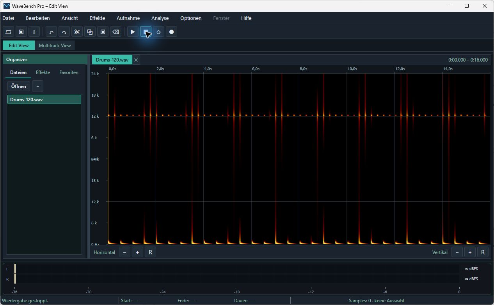
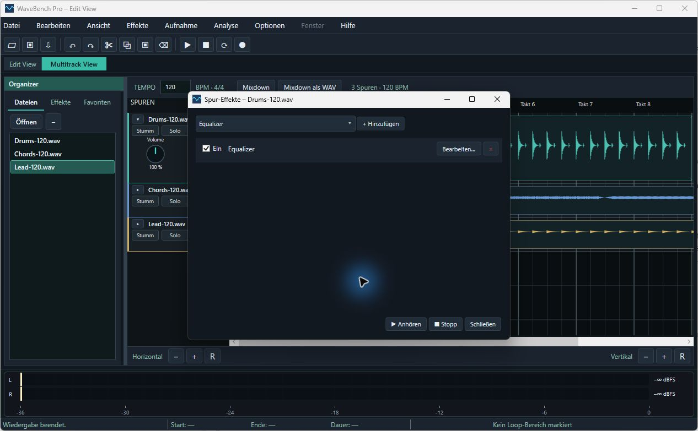

# User guide

## Project workflows (09A)

The **Datei** menu provides **Neues Mehrspurprojekt**, **Projekt öffnen**, **Projekt speichern**, **Projekt speichern unter**, **Projekt portabel speichern** and **Projekt wiederherstellen**. Save writes a `.wbproj` manifest and required assets. Portable saving copies every source into the adjacent `.assets` directory; move the manifest and that directory together.

When a project source is missing or changed, choose a replacement in the relink dialog. Its recorded length and SHA-256 must match before opening continues. Cancel leaves the current project intact. A relinked project remains modified until saved.

Recovery offers the newest valid unresolved generation for each project. Restore opens a modified project; Save commits it to the chosen project location. Discard resolves the offered recovery, while Later keeps it available. Recovery sources remain protected while the editor owns them.

Saving, opening and recovery report errors without replacing the current project on failure. Cancelling a save preserves the last committed manifest. Save before discarding changes; failed saves or additional edits keep the close/discard operation pending. Project operations require recording and pending audio finalization to finish first.

View selection, cursor, viewport, zoom and loop settings are stored in format v3. Existing v2 projects remain readable. Unused asset files may be retained to protect open documents and undo history.

The beta.3 package supports WAV import and export. Compressed audio formats and ASIO are disabled in this beta profile pending codec licensing review and hardware acceptance. Descriptions of these features elsewhere apply to the ordinary development build.

The interface currently uses German labels, included below.

## Import and editing

Use **Datei → Öffnen** or **Öffnen** in the organizer. WAVs use block access with background peaks; compressed imports decode into memory and can need substantial RAM.

Drag across the waveform to select audio. **Start**, **Ende** and **Dauer** show selection start, end and length. Cut/copy/paste/delete and undo/redo are under **Bearbeiten**. **Neu aus Auswahl** creates another document from the selected audio.

Bottom **+**, **−**, **R** groups zoom/reset each axis independently.

## Playback and metering

The top play/stop buttons control the active view. Selection playback repeats the marked region. Without a selection, the loop button enables repetition of the playback region.

The stereo meter shows peak/RMS, holds peaks and flags clipping. The peak clipper does not provide lookahead limiting or guarantee a streaming-service loudness target.

## Spectrogram

Toggle **Ansicht → Spektrogramm**. This time/frequency view helps locate tonal noise and transients. It represents audio over time, not a live spectrum analyzer. Analysis can take time.

## Multitrack

1. Open sources in the organizer.
2. Switch to **Multitrack View**.
3. Drag a file into a lane. An empty lane creates a track.
4. Move clips on the beat grid and set BPM. A BPM number in a sample filename can provide a hint; there is no beat detection.
5. Use the track header: **Stumm** (mute), **Solo**, **FX**, **×** (remove track). Expand the arrow for volume/pan.

Several tracks may be soloed together. Solo clears Stumm on that track, and Stumm clears Solo. If an occupied track is soloed, other tracks are excluded.

Drag on the timeline ruler to create a selection loop. Drag its edges to resize it or its body to move it. A simple click moves the cursor while preserving the selection. Outside clicks on a selection loop return to its beginning. Double-click the ruler to clear the selection.

**Mixdown als WAV** exports in blocks. Export length follows audible tracks; experimental playback keeps the full timeline so muted long tracks can be enabled live.

Use **Datei → Neues Mehrspurprojekt**, **Projekt öffnen**, **Projekt speichern** or
**Projekt speichern unter** for `.wbproj` files. Unchanged source files remain
references; changed/recorded audio is kept in the project asset folder. Every
two minutes, changed projects get up to three separate recovery generations in
the local WaveBench recovery folder; this never overwrites the consciously
saved project. A failed autosave is shown in the status bar. Details and limits:
[project format](ProjectFormat.md).

## Effects and VST3

Click **FX**, choose an effect and **Hinzufügen**. Native effects and installed VST3 inserts can be configured, enabled/disabled and removed. Track inserts leave original source files unchanged.

**Effekte → VST3-Effekte neu scannen** finds plugins. Scanning/running plugins loads third-party code into the app process; incompatible plugins can hang/crash it. Plugins are supplied/licensed separately. Stateful/nondeterministic effects can differ between live audition and a fresh offline render.

In the experimental engine, close the FX dialog to prepare changes and restart. Plugins are not called from the device callback.

## Recording

Choose input/output separately in **Optionen → Audio-Hardware** and explicitly select the intended recording device. Shared capture is the default. ASIO is disabled in the beta.3 profile pending acceptance. Record starts/stops capture; select the intended document/cursor first. See [Audio hardware](AudioHardware.md) for modes, formats, buffers and recovery.

On device/disk errors, read the displayed recovery-file path and secure that WAV. Recovery is failure handling, not project autosave.

## Export

Use **Datei → Exportieren**. Choose the codec and available parameters. Quality percentages are codec settings and are not equivalent bitrates between formats. Keep originals when making lossy copies. Unsupported oversized RIFF outputs are rejected; RF64 is not implemented.

## Experimental engine

Enable **Optionen → Mehrspur: neue Wiedergabe (experimentell)**. All occupied tracks are prepared into private float WAVs; **Abbrechen** requests cancellation. Long projects can take minutes.

The buffer menu offers 4/8/16 blocks, about 85/171/341 ms at 48 kHz plus device buffering. More buffering increases control latency. The status shows underruns/errors.

The cursor follows delivered source positions, pausing during underrun silence. Output-latency compensation is approximate, not an acoustic measurement.

Seeking/looping reads the continuous prepared render and its DSP/resampler/WSOLA history. DSP does not run onward across the loop boundary. Hard boundaries can click; automatic crossfades are not added.

After cleanup timeout, let the old worker finish before restarting. Resources remain owned while used. Native hangs cannot be forcibly interrupted without isolation. Turn the experimental option off to use the previous engine.

## Problems

Report [Issues](https://github.com/radioman82/WaveBenchPro/issues) with version, Windows, device, steps, format/rate/channels and engine selection. Prefer synthetic audio. Check screenshots/logs for private recordings, account paths and plugin keys before sharing.
